# LearnTrack – Student & Course Management System

A console-based Student & Course Management System built using **Core Java**, designed to practice Java fundamentals including OOP, Collections, Exception Handling, and clean modular design.

---

## Features

- **Student Management** — Add, view, search, and deactivate students
- **Course Management** — Add, view, activate/deactivate courses
- **Enrollment Management** — Enroll students in courses, view enrollments, update status (Completed/Cancelled)
- **Input Validation** — Graceful handling of invalid input with custom exceptions
- **Polymorphism Demo** — Startup demo showing method overriding via Person → Student/Trainer hierarchy

---

## Project Structure

```
LearnTrack/
├── src/
│   └── com/airtribe/learntrack/
│       ├── entity/             # Data model classes
│       │   ├── Person.java           (Base class)
│       │   ├── Student.java          (extends Person)
│       │   ├── Trainer.java          (extends Person)
│       │   ├── Course.java
│       │   ├── Enrollment.java
│       │   └── EnrollmentStatus.java (enum)
│       ├── service/            # Business logic
│       │   ├── StudentService.java
│       │   ├── CourseService.java
│       │   └── EnrollmentService.java
│       ├── ui/                 # Console interface
│       │   └── Main.java
│       ├── exception/          # Custom exceptions
│       │   ├── EntityNotFoundException.java
│       │   └── InvalidInputException.java
│       └── util/               # Utility/helper classes
│           ├── IdGenerator.java
│           └── InputValidator.java
├── docs/
│   ├── Setup_Instructions.md
│   ├── JVM_Basics.md
│   └── Design_Notes.md
└── README.md
```

---

## How to Compile and Run

### Prerequisites
- Java Development Kit (JDK) 17 or later installed
- Verify with: `java -version` and `javac -version`

### Compile
From the project root (`LearnTrack/`):

```bash
javac -d out src/com/airtribe/learntrack/entity/*.java \
              src/com/airtribe/learntrack/exception/*.java \
              src/com/airtribe/learntrack/util/*.java \
              src/com/airtribe/learntrack/service/*.java \
              src/com/airtribe/learntrack/ui/*.java
```

This compiles all source files and places the `.class` files into the `out/` directory.

### Run
```bash
java -cp out com.airtribe.learntrack.ui.Main
```

---

## Class Diagram

```mermaid
classDiagram
    class Person {
        -int id
        -String firstName
        -String lastName
        -String email
        +Person()
        +Person(id, firstName, lastName, email)
        +getDisplayName() String
        +getters/setters()
    }

    class Student {
        -String batch
        -boolean active
        +Student()
        +Student(id, firstName, lastName, batch)
        +Student(id, firstName, lastName, email, batch)
        +getDisplayName() String
    }

    class Trainer {
        -String specialization
        +Trainer()
        +Trainer(id, firstName, lastName, email, specialization)
        +getDisplayName() String
    }

    class Course {
        -int id
        -String courseName
        -String description
        -int durationInWeeks
        -boolean active
        +Course()
        +Course(id, courseName, description, durationInWeeks)
        +getters/setters()
    }

    class EnrollmentStatus {
        <<enumeration>>
        ACTIVE
        COMPLETED
        CANCELLED
    }

    class Enrollment {
        -int id
        -int studentId
        -int courseId
        -String enrollmentDate
        -EnrollmentStatus status
        +Enrollment()
        +Enrollment(id, studentId, courseId, enrollmentDate)
        +getters/setters()
    }

    class StudentService {
        -ArrayList~Student~ students
        +addStudent(Student) void
        +addStudent(firstName, lastName, email, batch) Student
        +findStudentById(id) Student
        +listAllStudents() ArrayList~Student~
        +deactivateStudent(id) void
        +updateStudent(id, ...) void
        +removeStudent(id) void
    }

    class CourseService {
        -ArrayList~Course~ courses
        +addCourse(Course) void
        +addCourse(courseName, description, duration) Course
        +findCourseById(id) Course
        +listAllCourses() ArrayList~Course~
        +activateCourse(id) void
        +deactivateCourse(id) void
    }

    class EnrollmentService {
        -ArrayList~Enrollment~ enrollments
        -StudentService studentService
        -CourseService courseService
        +enrollStudent(studentId, courseId) Enrollment
        +getEnrollmentsForStudent(studentId) ArrayList~Enrollment~
        +updateEnrollmentStatus(enrollmentId, status) void
        +listAllEnrollments() ArrayList~Enrollment~
    }

    class IdGenerator {
        -static int studentIdCounter$
        -static int courseIdCounter$
        -static int enrollmentIdCounter$
        +getNextStudentId()$ int
        +getNextCourseId()$ int
        +getNextEnrollmentId()$ int
    }

    class InputValidator {
        +isNonEmptyString(s)$ boolean
        +isPositiveInt(n)$ boolean
        +isValidEmail(email)$ boolean
    }

    class EntityNotFoundException {
        +EntityNotFoundException(message)
    }

    class InvalidInputException {
        +InvalidInputException(message)
    }

    Person <|-- Student
    Person <|-- Trainer
    Enrollment --> EnrollmentStatus
    StudentService --> Student
    CourseService --> Course
    EnrollmentService --> Enrollment
    EnrollmentService --> StudentService
    EnrollmentService --> CourseService
    StudentService ..> IdGenerator
    CourseService ..> IdGenerator
    EnrollmentService ..> IdGenerator
    StudentService ..> InputValidator
    EntityNotFoundException --|> Exception
    InvalidInputException --|> Exception
```



---

## Key Concepts Demonstrated

| Concept | Where |
|---|---|
| **Encapsulation** | All entity fields are `private` with public getters/setters |
| **Inheritance** | `Student` and `Trainer` extend `Person` |
| **Polymorphism** | `getDisplayName()` overridden in subclasses; demonstrated at startup |
| **Constructor Overloading** | `Student` has constructors with/without email |
| **Method Overloading** | `StudentService.addStudent()` has two signatures |
| **Static Members** | `IdGenerator` uses static counters and methods |
| **ArrayList** | All services use `ArrayList` for in-memory storage |
| **Custom Exceptions** | `EntityNotFoundException`, `InvalidInputException` |
| **Enums** | `EnrollmentStatus` (ACTIVE, COMPLETED, CANCELLED) |
| **Separation of Concerns** | Entity → Service → UI layers |

---

## Documentation

- [Setup Instructions](docs/Setup_Instructions.md) — JDK setup and Hello World
- [JVM Basics](docs/JVM_Basics.md) — JDK vs JRE vs JVM, bytecode, WORA
- [Design Notes](docs/Design_Notes.md) — Design decisions and rationale
